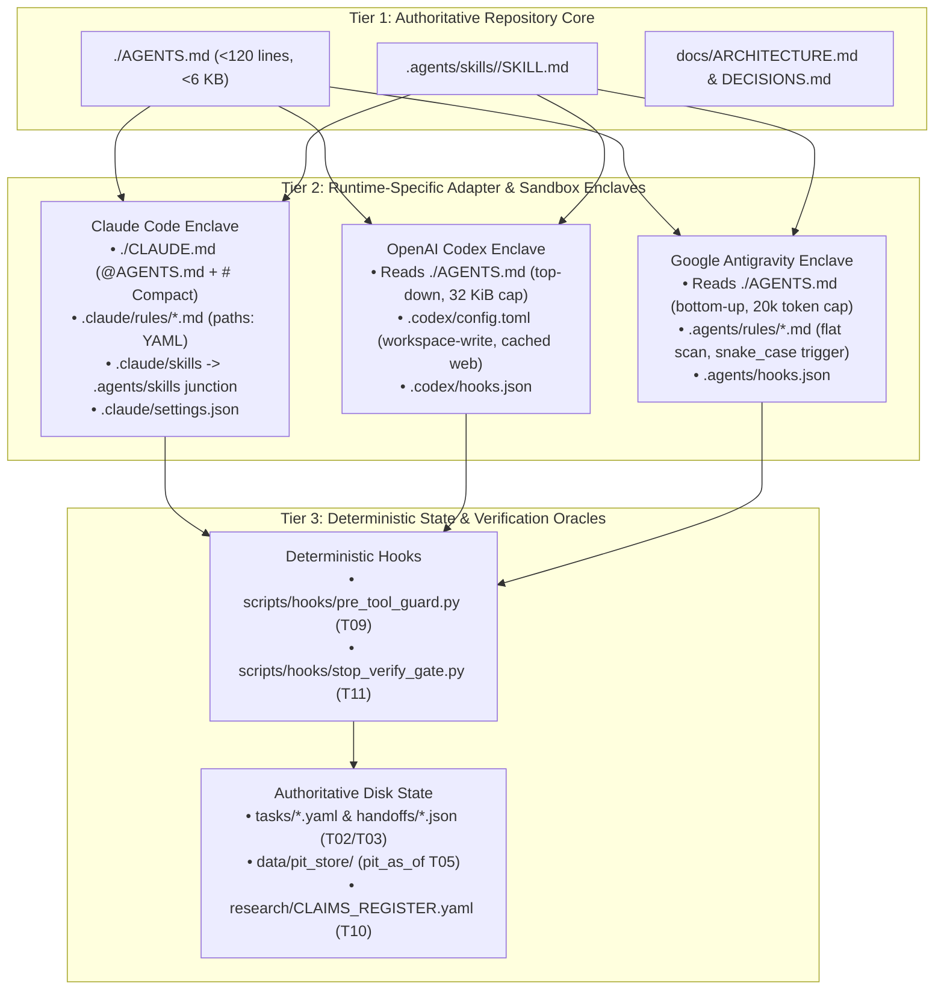

# Multi-AI Operating System — Technical Architecture Specification

**Document Version:** 1.0.0  
**Verification Date:** 28 October 2026  
**Authoritative Scope:** Tier 1–3 Policy Adapter Architecture, 8-Layer Platform Capability Matrix, Competing Architectures A–F Evaluation, 4-Tier Evidence Hierarchy Oracle, and Bitemporal PIT Data Store.

---

## 1. Architectural Overview & Core Design Principles

The Multi-AI Operating System coordinates **Anthropic Claude / Claude Code**, **OpenAI ChatGPT Work / Codex CLI**, and **Google Antigravity** around a local, version-controlled Git repository and an append-only DuckDB/SQLite/Parquet Point-in-Time (PIT) analytical state store (`data/pit_store/`).

Three foundational principles govern the architecture:
1. **Minimum Effective Complexity (P1-06 / T12):** Never deploy a multi-platform pipeline where a single primary agent paired with a deterministic test/SQL oracle (**Config 1**) satisfies all hard constraints at lower **Total Cost per Verified Successful Outcome (TCVSO)**. Escalate to two-platform isolated Git worktree handoffs (**Configs 2, 3, 5**) only where independent cross-family verification measurably reduces defect escape rates and TCVSO.
2. **Disk State as Sole Authority (P0-05 / P1-09 / T02):** A shared Git repository does *not* synchronise prompt caches, in-memory tool sessions, approval grants, or platform auto-memories (`~/.claude/projects/.../memory`, `~/.codex/memories/`, `~/.gemini/antigravity/brain/`). All durable coordination occurs strictly through schema-validated files on disk (`tasks/*.yaml`, `handoffs/*.json`, `research/CLAIMS_REGISTER.yaml`).
3. **Deterministic Enforcement over Discretionary Prompts (P1-08 / P1-12 / T04 / T09 / T11):** Markdown instructions (`AGENTS.md`, `CLAUDE.md`) guide agent behaviour, but hard safety boundaries and completion gates are enforced deterministically by OS kernel sandboxes and Python lifecycle hooks (`scripts/hooks/pre_tool_guard.py` and `scripts/hooks/stop_verify_gate.py`).

---

## 2. Three-Tier Authoritative Policy & Adapter Model (Solving P1-07)

Placing uncoordinated `CLAUDE.md`, `AGENTS.md`, and `GEMINI.md` files in the same repository causes silent rule omissions due to three incompatible discovery mechanisms verified on 28 October 2026:
- **Claude Code Exclusivity Trap:** If both `CLAUDE.md` and `AGENTS.md` exist at the root, Claude Code loads `CLAUDE.md` only and ignores `AGENTS.md` unless `CLAUDE.md` explicitly imports `@AGENTS.md`.
- **Opposite Directory-Walk Order Trap:** OpenAI Codex walks **top-down** (`~/.codex/` -> Git root -> `$CWD`, 1 file per directory, 32 KiB default cap), whereas Google Antigravity walks **bottom-up** (`$FILE_DIR` -> workspace root, cumulatively combining `AGENTS.md`, `GEMINI.md`, and flat `.agents/rules/*.md` up to 24 KB per file and 20,000 tokens total).
- **Unified Skills Standard:** Both OpenAI Codex and Google Antigravity natively scan `.agents/skills/<name>/SKILL.md`, while Claude Code scans `.claude/skills/<name>/SKILL.md` and follows directory junctions/symlinks.

---

## 3. Eight-Layer Cross-Platform Capability Matrix (P0-04)

| Layer | Anthropic Claude Ecosystem | OpenAI ChatGPT / Codex Ecosystem | Google Antigravity Ecosystem |
| :--- | :--- | :--- | :--- |
| **1. Execution Surfaces** | `claude.ai` (Unified Chat/Cowork), Claude Desktop, Claude Code CLI (`claude` v2.1.305+), VS Code/JetBrains, Agent SDK. | ChatGPT Work, Codex CLI (`codex` v0.159.0+), Codex IDE extensions, Codex Cloud, Agents API. | Antigravity App (v2.23+), CLI (`agy` v1.4.4+), VS Code & VS 2026 GA extensions, Python SDK. |
| **2. Flagship Models & Context** | **Haiku 5.5**, **Sonnet 5.5** ($2/$10), **Opus 5.5** ($4/$20), **Fable 5/5.1** ($10/$50); 1M context on paid tiers. *(4.7+ tokenizer uses ~30–35% more tokens)*. | **GPT-6 Luna** ($0.10/$0.50), **GPT-6.1 Terra** ($1/$5), **GPT-6.1 Sol** ($2/$10, 500k default), **GPT-6 Astra** ($10/$50). | **Gemini 3.8 Flash** ($0.75/$3.75), **Gemini 4 Argon** ($2/$10 intro -> $4/$20 Dec 1, 1M context); 3rd-party **Claude Sonnet/Opus 5.5**. |
| **3. Prompt Caching Mechanics** | 95% read discount ($0.10/MTok on Sonnet 5.5); 5m write 1.25x ($2.50), 1h write 2.0x ($4.00). Model switch busts cache. | 95% read discount ($0.10/MTok on Sol); 30m write 1.25x ($2.50), 12h write 2.5x ($5.00). | Implicit caching on Gemini 4 Argon ($0.10/MTok read, no write fee); explicit cache on 3.8 Flash. |
| **4. Instruction Discovery** | `./CLAUDE.md` (imports `@AGENTS.md`), `.claude/rules/*.md` (`paths:` globs). | Top-down walk (`AGENTS.override.md > AGENTS.md`), 1 file/dir, 32 KiB cap. | Bottom-up walk (`AGENTS.md`, `GEMINI.md`, flat `.agents/rules/*.md` with snake_case `trigger:`), 24 KB/file cap. |
| **5. Skills Standard** | `.claude/skills/<name>/SKILL.md` (junctioned to `.agents/skills/`). | `.agents/skills/<name>/SKILL.md` (capped at 2% context / 10k tokens). | `.agents/skills/<name>/SKILL.md` (legacy `.agents/workflows/` deprecated 19 Oct 2026). |
| **6. Lifecycle Hooks** | `.claude/settings.json` (`SessionStart`, `PreToolUse`, `PostToolUse`, `Stop`). | `.codex/hooks.json` (`PreToolUse`, `PostToolUse`, `Stop`). | `.agents/hooks.json` (`PreToolUse`, `PostToolUse`, `Stop`) + Sidecars. |
| **7. Subagents & Worktrees** | `Explore`, `Plan`, `.claude/agents/*.md`, `claude --worktree`. (`Agent Teams` disabled: 7x token cost). | `default`, `worker`, `explorer`, `.codex/agents/*.toml`, `/worktree`, `/review`. | `research`, `browser` (Chrome + WebM capture), `self`, worktree branch mode. |
| **8. OS Sandbox Enforcement** | `acceptEdits`, strict `deny > ask > allow` in `.claude/settings.json`. | `sandbox_mode = "workspace-write"`, `approval_policy = "on-request"`, `web_search = "cached"`. | `toolPermission: "proceed-in-sandbox"`, `enableTerminalSandbox: true`, `useG1Credits: false`. |

---

## 4. Evaluation of Competing Multi-Platform Architectures (Architectures A–F)

| Architecture | Description | Modeled TCVSO (Workload A / B / C) | Verdict & Operational Disposition |
| :--- | :--- | :--- | :--- |
| **Arch A: Manual File Handoffs** | Single primary platform + human-triggered file handoff (`tasks/*.yaml`, `handoffs/*.json`) when verification is needed. | £6.40 / £5.10 / **£8.45** | **Retain (Baseline for Solo Tasks & Workload C):** Zero infrastructure overhead; compliant with standard subscriptions. |
| **Arch B: Shared Git Repo + Worktrees** | Isolated Git worktrees per agent governed by unified `AGENTS.md` + `CLAUDE.md` adapter and deterministic hooks. | £5.95 / £4.75 / £8.80 | **Retain (Foundation for Multi-Platform Work):** Prevents concurrent edit race conditions (T03). |
| **Arch C: Central Custom Orchestrator** | External daemon wrapping all 3 vendor CLIs/APIs in an automated router. | £12.42 / £11.80 / £14.20 | **Reject for Subscription Workflows (`RJ-01`):** Violates consumer ToS (wrapping `agy -p` / Claude subscriptions) and doubles TCVSO via API + maintenance overhead. |
| **Arch D: Event-Driven / Cron Sidecars** | Scheduled background jobs (Antigravity sidecars, Claude `/schedule`, Codex automations). | Conditional | **Conditional:** Restricted strictly to read-only nightly PIT integrity checks and dependency audits; never unattended writes. |
| **Arch E: Specialist Agent Swarms** | Continuous multi-agent teams (`CLAUDE_CODE_EXPERIMENTAL_AGENT_TEAMS=1` or 3-vendor live swarms). | £14.10 / £14.90 / £15.37 | **Reject for Write-Heavy Work (`RJ-01`):** ~7x token multiplier in plan mode, cache invalidation, and broken `/resume` state. |
| **Arch F: Pragmatic Hybrid (Target OS)** | Combines **Arch B** (Git worktrees) + **Level 1 Deterministic Oracles** (`pytest`, `dotnet run`, `pit_as_of`) + **Cross-Family Adversarial Review** (Claude builds -> Codex `gpt-6.1-sol` `/review` or Antigravity `/browser` verifies). | **£5.76** / **£4.60** / **£8.45** | **Retain (Target Production Operating System — Configs 1, 2, 3, 5):** Lowest verified TCVSO across all three priority workloads. |

---

## 5. Four-Tier Evidence Hierarchy Oracle (Solving P1-12 & T04)

Cross-model consensus is never accepted as verification. When an implementing agent and a reviewing agent disagree—or when both agree on a state calculation or factual claim—verification is adjudicated strictly by the **Four-Tier Evidence Hierarchy Oracle** (`src/verification/evidence_oracle.py`):

1. **Level 1 — Deterministic Execution Oracle (Highest Authority):** Automated test suite exit codes (`unittest` / `pytest`, `dotnet run`), static typecheckers (`mypy`), DuckDB/SQLite bitemporal invariance queries (`pit_as_of`), and SHA-256 file checksums. **Rule:** If Level 1 fails (`exit_code != 0`), unanimous agreement across Claude, GPT, and Gemini is automatically overruled (**T04**).
2. **Level 2 — Primary Source & Ground-Truth Oracle:** Official vendor/system documentation with an exact URL and `verified_date` in `research/CLAIMS_REGISTER.yaml`, or immutable raw telemetry records in `data/pit_store/`.
3. **Level 3 — Cross-Family Adversarial Competing-Hypothesis Check:** For architectural trade-offs lacking a deterministic oracle, an auditor from a *different* model family must articulate an explicit **Rival Explanation / Falsification Hypothesis** before scoring the proposal.
4. **Level 4 — Human Arbitration Gate:** Unresolved contradictions between Level 2 and Level 3 halt execution and record a structured blocker in `tasks/ACTIVE_TASK.yaml`.

---

## 6. Bitemporal Point-in-Time (PIT) Data Architecture (Solving T05 & P1-10)

All system state and analytical observations in `data/pit_store/` enforce an **Eight-Timestamp Bitemporal Schema** (`src/bitemporal/pit_schema.sql` & `src/bitemporal/pit_loader.py`):
- **Business & Event Timestamps:** `event_time_utc` (sampling interval end in UTC), `exchange_tz` / `source_tz` (IANA timezone), `published_at_utc` (official upstream emission), `first_avail_utc` (collector arrival), `valid_from_utc`, `valid_to_utc`.
- **System Transaction Timestamps:** `ingested_at_utc` (immutable write time to `pit_store`), `superseded_at_utc`.
- **As-Of Query Invariant (`pit_as_of(cutoff_ts)`):** Filters `valid_from_utc <= cutoff_ts AND ingested_at_utc <= cutoff_ts AND tombstone_status IN ('ACTIVE', 'CORRECTED')` and selects the latest revision known as of `cutoff_ts` via `ROW_NUMBER() OVER (PARTITION BY entity_id, metric_name, event_time_utc ORDER BY ingested_at_utc DESC, revision_num DESC) = 1`.
- **Immutability vs. Erasure Reconciliation (P1-10):** Revisions append a new row with `revision_num + 1`. GDPR or license-expiry deletions purge the external upstream blob in `data/payloads/vendor=<v>/` while preserving the row metadata with `metric_value = NULL` and `tombstone_status = 'REDACTED_PII'` or `'LICENSE_EXPIRED'`, maintaining unbroken cryptographic audit lineage (`raw_payload_sha256`).
